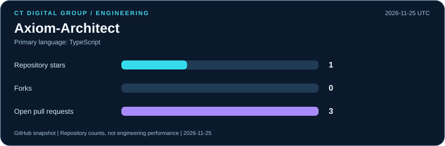

<div align="center">

# AXIOM ARCHITECT

### The architecture behind intelligent work.

**Workflow diagnostics · AI system design · Implementation blueprints**

[Explore Axiom Architect](https://axiom-architect.co) · [Axiom Studio](https://axiom-studio.co)

</div>

---

## Make complex work understandable

Axiom Architect is an AI-supported workflow architecture project for founders, operators, consultants, creators and small teams.

Its focus is turning fragmented business processes into a structured picture of **how work moves**, **where friction appears** and **which improvements are practical**. The intended output is not another vague AI recommendation: it is a diagnostic and a blueprint that can inform implementation decisions.

## The Axiom Workflow Audit

The primary service being developed is the **Axiom Workflow Audit**.

The intended flow is:

1. Understand the audit and its deliverables.
2. Begin the service flow and provide a structured workflow intake.
3. Review how the process operates, where handoffs break down and what can be improved.
4. Identify opportunities for automation and AI-supported execution.
5. Produce a structured diagnostic and implementation blueprint.

The codebase includes integrations supporting the intended service flow. **This description is a product direction, not a claim that every step is fully launched or automated.**

## What we're building

| Capability | Purpose |
|:--|:--|
| **Workflow diagnostics** | Find bottlenecks, duplicated effort and unclear handoffs |
| **Automation suitability** | Distinguish useful automation from cases that need human judgement |
| **Operating models** | Map responsibilities, steps, review gates and information flow |
| **Implementation blueprints** | Turn findings into a practical, structured improvement plan |
| **Human-in-the-loop design** | Make accountability and oversight part of the proposed system |

## Architecture and technology

The repository uses **Next.js App Router**, **React**, **TypeScript** and **Tailwind CSS**.

The documented development architecture includes **Vercel**, **Supabase**, **Stripe** and **Resend**. Integrations and availability should be confirmed against each deployed environment rather than inferred from repository contents.

See [package.json](./package.json) for the current dependencies and [AGENTS.md](./AGENTS.md) for the project's engineering constraints.

## Design language

Axiom Architect takes a restrained technical direction: near-black surfaces, mint highlights, structured grids, thin outlines and blueprint-inspired diagrams.

The goal is a clear, premium interface that makes process architecture easier to understand, not a decorative dashboard with invented statistics.

## Development

The source is provided to showcase the project's engineering direction and ongoing development.

```bash
npm ci
npm run dev
```

To validate a production build:

```bash
npm run build
```

Runtime credentials and service configuration are not included here. Never commit environment files, API keys, customer information or private exports.

### Working principles

- Make focused, reviewable changes rather than unrelated rewrites.
- Keep source and deployed behaviour clearly distinguished.
- Verify changes with an application build before merging code updates.
- Keep customer data and service credentials outside version control.
- Treat operational reliability and human review as design requirements.

## Current status

**Active development.** The repository is public for project visibility and technical documentation. Product plans and repository code should not be mistaken for evidence that every service or integration is live.

## Related work

**[Axiom Studio](https://axiom-studio.co)** — related digital resources and product work.

**[CT DIGITAL GROUP](https://ctdigital.group/)** — AI systems, automation and digital operations.

---

<div align="center">

**Diagnose clearly. Design deliberately. Build what matters.**

</div>
<!-- CTDG-ENGINEERING-START -->
## CTDG engineering intelligence

    



| Repository detail | Verified snapshot |
| --- | --- |
| Primary language | TypeScript |
| Repository stars | 1 |
| Forks | 0 |
| Open pull requests | 3 |
| Data date (UTC) | 2026-11-25 |

[CT DIGITAL GROUP](https://ctdigital.group/) · [Repository activity](https://github.com/colintandyonline/Axiom-Architect/activity) · [Pull requests](https://github.com/colintandyonline/Axiom-Architect/pulls)

Statistics are a point-in-time GitHub snapshot, not an indication of release readiness.
<!-- CTDG-ENGINEERING-END -->
